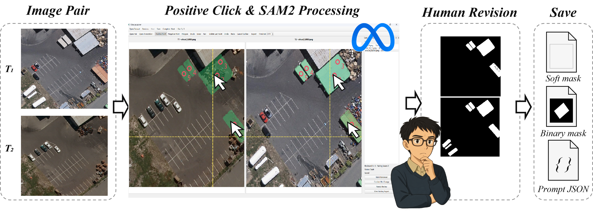
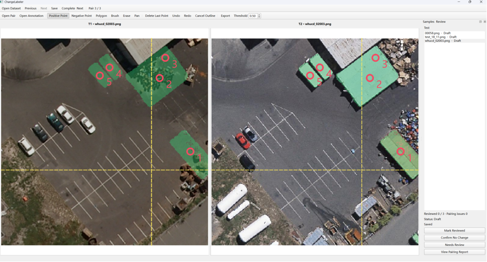
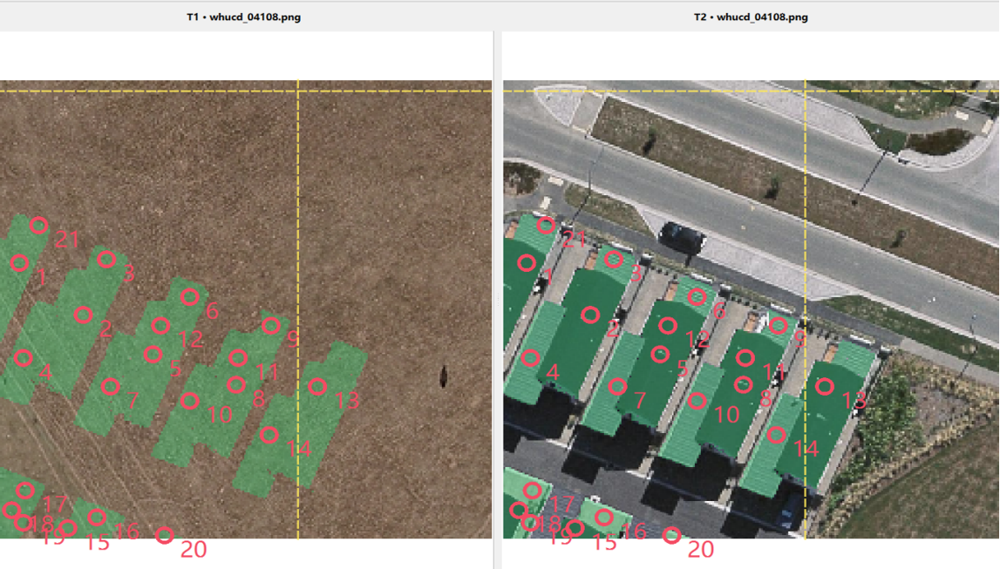

<p align="center">
  
</p>

<h1 align="center">Point2Change</h1>

<p align="center">
  <a href="#quick-start">Get started</a> ·
  <a href="#operation-demo">Video</a> ·
  <a href="#annotation-workflow">Workflow</a> ·
  <a href="#examples">Examples</a>
</p>

## About

Point2Change is a local desktop tool that turns clicks into change-mask
suggestions for registered image pairs. It combines SAM 2 proposals with a
change response map so you can focus on reviewing and refining annotations.

- **Prompt with points.** Click changed objects in either image and add negative points to correct unwanted regions.
- **Refine with control.** Inspect synchronized T1/T2 views, adjust the threshold, and edit masks with a brush, polygon, or eraser.
- **Save and review.** Autosave dataset annotations, track review status, and export masks and prompt metadata.

## Operation demo

https://github.com/user-attachments/assets/58ae25d7-f25b-4e96-986c-7b1db5728bc4

Watch a recording of Point2Change in use.

## Annotation workflow

**Image pair → Point prompts + SAM 2 → Human revision → Save & export**

<p align="center">
  <a href="docs/assets/framework.png"></a>
</p>

Start with two registered images, click the changed objects, review the proposed
regions, and refine them as needed. Save the annotation for continued editing
or export soft masks, binary masks, and prompt metadata.

## Examples

### Case 1 · Localized changes

A small set of positive point prompts guides mask proposals for changed objects
in a parking-area scene. Both dates display the proposed regions for inspection.

<p align="center">
  <a href="docs/assets/case-01.png"></a>
</p>

### Case 2 · Multiple building changes

Point prompts guide candidate masks across a group of buildings between the two
dates. The paired view supports checking each proposed footprint before review.

<p align="center">
  <a href="docs/assets/case-02.png"></a>
</p>

The examples show interactive annotation suggestions, not ground-truth masks
or quantitative evaluation results. Click any figure to view the original image.

## Requirements

- Python 3.10–3.12; Python 3.11 is a good starting point for a new environment.
- A desktop environment capable of running PySide6/Qt.
- PyTorch and TorchVision versions within the ranges in `requirements.txt`.
- The original **SAM 2 Hiera Large** checkpoint, downloaded separately.

CUDA is selected automatically when available; otherwise inference uses the CPU.
CPU inference can be slow with the large model. The project was developed on
Windows; other desktop platforms have not been verified for this release.

## Quick start

### 1. Clone the repository

```shell
git clone https://github.com/hao-wang1216/Point2Change.git
cd Point2Change
```

### 2. Create an environment and install dependencies

Using Conda:

```shell
conda create -n point2change python=3.11 -y
conda activate point2change
python -m pip install --upgrade pip
python -m pip install -r requirements.txt
```

Alternatively, use a Python virtual environment. On Windows PowerShell:

```powershell
python -m venv .venv
.\.venv\Scripts\Activate.ps1
python -m pip install --upgrade pip
python -m pip install -r requirements.txt
```

For a CUDA-specific PyTorch installation, use the
[official PyTorch version instructions](https://pytorch.org/get-started/previous-versions/)
to install a matching `torch`/`torchvision` pair compatible with your driver and
the version ranges in `requirements.txt`, then install the remaining requirements.

The SAM 2 runtime is included in this repository. Run from the repository root;
a separate `pip install sam2` is not required. The image annotation workflow
uses the default predictor settings without the optional compiled CUDA extension.
Precompiled extensions are not distributed here.

### 3. Download the model checkpoint

Download [the original SAM 2 Hiera Large checkpoint](https://dl.fbaipublicfiles.com/segment_anything_2/072824/sam2_hiera_large.pt)
and place it at:

```text
Point2Change/
└── models/
    └── sam2_hiera_large.pt
```

For example, from the repository root in Windows PowerShell:

```powershell
curl.exe -L --fail --output models/sam2_hiera_large.pt "https://dl.fbaipublicfiles.com/segment_anything_2/072824/sam2_hiera_large.pt"
```

Use the original **SAM 2** checkpoint, not a SAM 2.1 checkpoint. The bundled
configuration is `sam2_configs/sam2_hiera_l.yaml`.

To keep the checkpoint elsewhere, set its path before starting the application:

```powershell
$env:CHANGE_LABELER_MODEL = "D:\Models\sam2_hiera_large.pt"
```

On Linux/macOS shells, the equivalent is:

```shell
export CHANGE_LABELER_MODEL="/path/to/sam2_hiera_large.pt"
```

`CHANGE_LABELER_MODEL` retains its original name for compatibility.
Weights are excluded from Git and must be downloaded separately.

### 4. Start the application

```shell
python run.py
```

The model loads after the first valid positive point. The window can open
before the checkpoint is available, but automatic mask generation requires it.

## Annotate a dataset

Prepare two folders containing registered, equally sized RGB image pairs:

```text
my_dataset/
├── T1/
│   ├── sample_001.png
│   └── sample_002.png
└── T2/
    ├── sample_001.png
    └── sample_002.png
```

1. Click **Open Dataset** and select `my_dataset`, the parent of `T1` and `T2`.
2. Choose **Positive Point** and click a changed object in either view.
3. Add more positive points for other changed objects and negative points to correct false positives.
4. Refine the mask with the brush, polygon, or eraser and adjust the threshold as needed. Double-click to finish a polygon.
5. Review the result and mark it reviewed, confirm no change, or flag it for another review.
6. Move to the next pair using the dataset list or keyboard shortcuts.

Images are matched by full relative filename, including extension, with natural
sorting. Nested directories are supported. Missing, damaged, or differently sized
pairs are reported; valid pairs can still be annotated. Filenames are matched
case-insensitively on Windows.

Edits are automatically saved after approximately 0.9 seconds of inactivity and
before changing samples or closing the application. Reopening the dataset
restores the last selected sample and its annotation state. Editing a reviewed
annotation returns it to draft status.

For a single pair, click **Open Pair** and select the two images. Save or export
the annotation explicitly; dataset autosave applies when a dataset is open.

## Saved annotations and exports

Dataset annotations are stored alongside the images:

```text
my_dataset/
├── T1/
├── T2/
└── annotations/
    ├── project.json
    └── sample_001.png/
        ├── annotation.json
        └── rev-<revision-id>/
```

Each saved annotation includes point prompts, the threshold, review status,
manual corrections, and a full-precision soft mask. Source image paths are
relative to the dataset root so that the dataset can be moved as a unit.

Use **Export** to write the current sample into a selected directory:

| File | Contents |
| --- | --- |
| `<name>_binary.png` | Binary change mask with values 0 and 255, including manual edits |
| `<name>_soft.png` | 8-bit probability mask |
| `<name>_manual.png` | Optional manual overrides: 0 unchanged, 127 forced background, 255 forced change |
| `<name>.json` | Image paths, prompts, threshold, review state, and mask filenames |

## Keyboard shortcuts

| Shortcut | Action |
| --- | --- |
| Ctrl+U | Open a dataset |
| A / D | Previous / next pair |
| Ctrl+S | Save the current sample |
| Ctrl+Enter | Complete and move to the next pair |
| Ctrl+Z / Ctrl+Y | Undo / redo |
| Esc | Cancel an unfinished polygon |

## Troubleshooting

- **Checkpoint not found:** check `models/sam2_hiera_large.pt` or the path in `CHANGE_LABELER_MODEL`.
- **Checkpoint loading error:** use the original SAM 2 Hiera Large checkpoint matching the bundled configuration.
- **CUDA is unavailable:** check the installed PyTorch build and NVIDIA driver. CPU fallback is automatic.
- **CUDA runs out of memory:** close other GPU applications or start with CUDA hidden (`$env:CUDA_VISIBLE_DEVICES = "-1"` in PowerShell) to use the CPU.
- **No valid pairs:** select the parent of `T1` and `T2`, then check relative filenames, extensions, and image dimensions.
- **Qt fails to start:** use a desktop session and install dependencies in the active Python environment.

## Scope

Inputs must already be spatially registered and have identical pixel dimensions.
PNG, JPEG, and TIFF inputs are read as RGB images. The application does not
perform image registration, tiled processing of large GeoTIFFs, or georeferenced
vector export. No standalone executable, datasets, or pretrained weights are
included in this repository.

## Acknowledgments and third-party licenses

Mask proposals use [SAM 2](https://github.com/facebookresearch/sam2) by Meta.
The desktop interface uses PySide6. See [THIRD_PARTY_NOTICES.md](THIRD_PARTY_NOTICES.md),
[LICENSE](LICENSE), and [LICENSE_cctorch](LICENSE_cctorch) for the bundled
SAM 2 runtime's license notices. Dependencies retain their own licenses.
